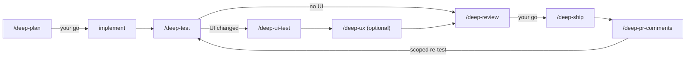

# deep-skills

A gated workflow for coding agents: plan before any code, prove the change with tests and a real browser, review it twice, then ship it.

These are the skills I use every day to build production software with Claude Code. The agent writes the code; these skills make sure it builds the right thing, doesn't break anything else, and leaves proof.

## Why

Coding agents fail in two expensive ways: they build the wrong thing because a requirement was misread or an assumption went unspoken, and they break unrelated code because nobody mapped the blast radius. deep-skills puts a process around the agent that catches both:

- **Hard gates.** Nothing is implemented until you say go, and nothing is shipped until you say go.
- **Evidence, not vibes.** Every claim about current behaviour points at a file and line, a ticket, or command output. Anything unverified is labelled as an assumption.
- **Questions with recommendations.** The agent never asks what the code, git history or docs can answer. Real decisions come to you as numbered questions with a recommended answer.
- **Tests that prove behaviour.** Edge cases that can really happen, tests that fail when the behaviour breaks, and an audit of the tests the implementation added.
- **A real browser.** UI changes are run through a scenario matrix across roles, states, viewports and locales, with console and network watched.
- **A second pair of eyes.** `/deep-review` runs its own pass plus an independent reviewer agent in parallel.
- **A work doc that survives sessions.** Every step reads and writes one document per piece of work, so a new session or a compacted one continues where the last one stopped.

## The flow



Run each step by hand, or let `/deep-feature` conduct the whole flow: it decides the next step, skips what doesn't apply, runs each heavy step in a fresh agent so its own context stays small, relays every question to you, and stops at both gates.

## The skills

| Skill | What it does |
| --- | --- |
| `deep-feature` | Conducts the whole flow from a ticket or spec, and resumes it from the work doc in any session |
| `deep-plan` | Reads all the material, maps the code and its blast radius, designs the smallest correct change, sweeps edge cases, plans tests, and asks every open question. Implements only after your go |
| `deep-test` | Models what each changed unit does, finds the edge cases that can really happen, audits and adds unit and integration tests, and fixes the bugs it finds |
| `deep-ui-test` | Turns requirements into a scenario matrix and runs it in a real browser across roles, states, viewports and locales; audits and extends e2e tests |
| `deep-ux` | Walks the changed screens as a first-time user and returns ranked UX suggestions, prototyped live in the browser. Changes nothing until you pick |
| `deep-review` | Reviews the branch against the plan and requirements, twice: its own pass and an independent reviewer. Runs formatter, linter, type checks and tests, fixes what's straightforward, asks about the rest |
| `deep-ship` | Commits only what belongs to the work, in the repo's commit convention, pushes safely, and opens or updates a reviewer-facing PR in every touched repo |
| `deep-pr-comments` | Collects review comments (including bot reviewers), checks each claim against the code, fixes the valid ones with tests, and drafts replies |

## Install

### Claude Code (plugin)

```
/plugin marketplace add oguzsabi/deep-skills
/plugin install deep-skills@deep-skills
```

### Claude Code, Codex, Cursor, OpenCode and other agents

```
npx skills add oguzsabi/deep-skills -g
```

`-g` installs for every project; leave it off to install into the current one. Add `--agent codex` (or `claude-code`, `cursor`, `opencode`, `github-copilot`) to install for one agent only.

### By hand

Copy the folders in `skills/` into your agent's skills directory (Claude Code: `~/.claude/skills/`; Codex: `~/.agents/skills/`). Every folder is self-contained, so you can copy all eight or just the ones you want.

## Quick start

On a branch you already have, with no setup:

```
/deep-review
```

It reviews the branch against its ticket or commits, runs your formatter, linter, type checks and tests, fixes what's straightforward and asks about the rest. If that's useful, try the whole flow on your next ticket:

```
/deep-feature <ticket link, spec or description>
```

It plans first and asks its questions with recommended answers. Nothing is implemented until you say go, and nothing is shipped until you say go again. To drive the steps yourself, start with `/deep-plan <ticket>` and follow the next step each skill names.

## Requirements

- **git**, and **gh** (GitHub) or **glab** (GitLab) for `deep-ship` and `deep-pr-comments`.
- **A browser tool** for `deep-ui-test` and `deep-ux`: Claude in Chrome, a Playwright MCP server, a built-in browser pane, or any tool that can navigate, click, resize and read the console and network.
- **Optional:** a code-graph or semantic index (for example tokensave or trail) for faster code mapping. Without one, the skills use grep and file reads.
- **Optional:** [Herdr](https://herdr.dev) for `deep-feature`'s tab mode, where each step runs in its own visible terminal tab. Without it, steps run as subagents.

## Your repo's rules win

Every skill reads `CLAUDE.md`, `AGENTS.md`, `CONTRIBUTING.md` and the docs index first. Where your repo's conventions differ (commit style, test commands, base branch, doc locations), the repo wins. The skills supply the process; your repo supplies the conventions.

## When not to use it

This is a heavy process on purpose. For a one-line fix, a typo or a quick experiment, skip it. Use it when a change is big enough that building the wrong thing or breaking something would cost more than an hour of agent time.

## Working on the skills

Reference files that several skills read (the workflow, the implementation rules, the test bar and a few more) live in one skill and are copied into the others, so each folder stands alone. [`scripts/shared.json`](scripts/shared.json) lists them. Edit the source, never a copy, then:

```
node scripts/sync-shared.mjs   # refresh the copies
node scripts/check.mjs         # frontmatter, references, copies, manifests, versions, README links
```

CI runs the check on every push and pull request. Changes are listed in the [changelog](CHANGELOG.md).

## License

MIT
