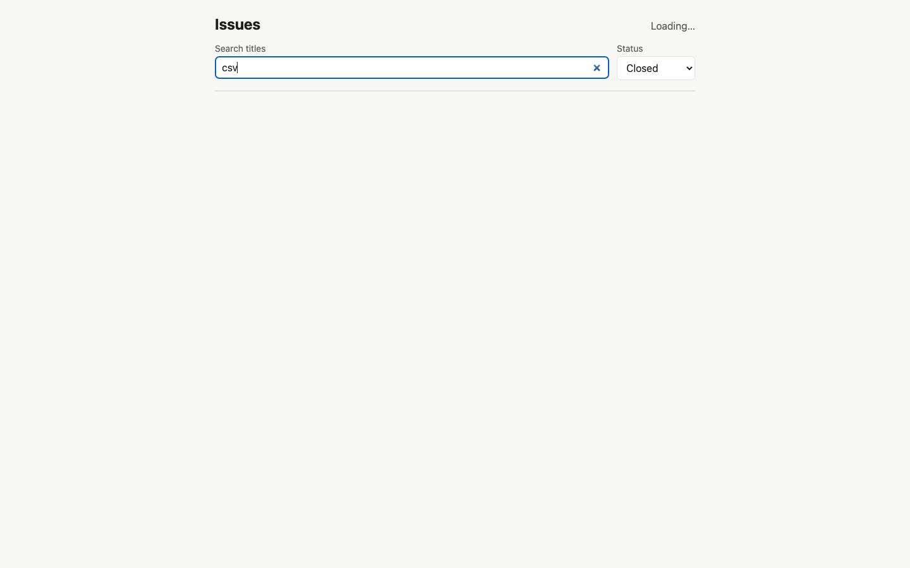
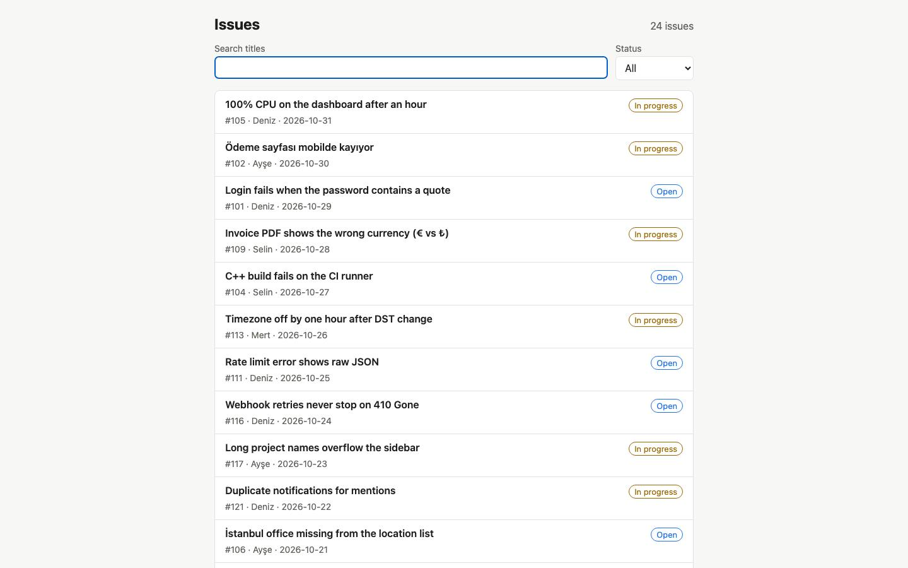
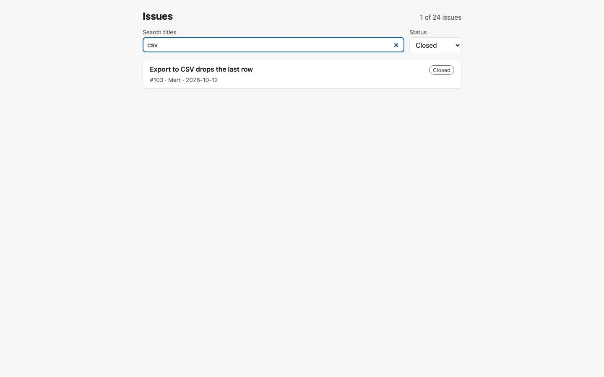
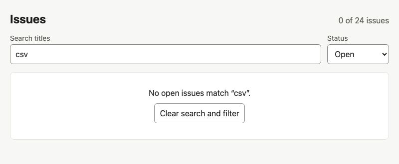

# Example: one ticket through `/deep-feature`

A real run of the whole flow on a small app, kept as it happened: the work doc every step wrote, the screenshots they took, and the code they produced.

- **The app:** [issue-list](issue-list/), a one-page issue list (plain HTML, CSS and JavaScript modules, a Node static server) with unit and Playwright tests. It was made for this example; the run treated it like any other repo.
- **The ticket:** [#12 Search and filter the issue list](issue-list/docs/tickets/12-search-and-filter.md): a search box, a status filter, both kept in the URL, a back button that works, and an empty state.
- **The work doc:** [docs/features/12-search-and-filter.md](issue-list/docs/features/12-search-and-filter.md): the plan, every decision, each step's results, and the Flow table the conductor kept.
- **The code:** commit `feat(issue-list): search and filter the issue list (#12)`, on top of the starting point `feat(examples): add issue-list app as the deep-feature example's starting point`.

## How it went

| # | Step | Rounds | What it did |
|---|------|--------|-------------|
| 1 | deep-plan | 1 | Read the ticket and code, found the gaps the ticket left open (how back should step through typing, how Turkish letters should match), asked 4 questions and stated 5 defaults |
| – | **gate** | | The user said go |
| 2 | implement | 1 | Built it in the plan's 6 steps, each with a check |
| 3 | deep-test | 2 | No bugs; unit tests 4 → 22, each new test proven by breaking the code it guards |
| 4 | deep-ui-test | 2 | Ran 26 scenarios at 8 viewport sizes in a real browser; found the bug below |
| 5 | deep-ux | 1 | Walked the page as a first-time user; 7 ranked suggestions, prototyped live; 6 built |
| 6 | deep-review | 2 | Own pass plus an independent reviewer; fixed 11 more issues |
| – | **gate** | | The user said go |
| 7 | deep-ship | 1 | Committed and opened the PR |

The user answered 20 questions, all as numbered lists, most with "all recommended", and gave the two go's. Everything else ran without them.

## What the steps caught

Each of these passed every test that existed when it was found.

- **Typing before the page's script loads was lost** (deep-ui-test). On a slow connection the search box shows before the script runs; whatever was typed there was wiped when the script started. The user chose to keep it; the fix has an e2e test that holds the script back.

  | Typed before the script ran | After the script ran (bug) | After the fix |
  |---|---|---|
  |  |  |  |

- **Safari stopped updating the list** after about 100 URL changes in 10 seconds, its limit on history writes (deep-review, reproduced in WebKit). A later round found that a refused write was never retried, so the URL could stay out of step with the screen.
- **Going back two pages showed the wrong status** in Chrome, because the browser restored the select's value over the URL (deep-review).
- **Focus fell to the page** when back/forward hid a focused button (deep-review).
- **Turkish search:** `'İstanbul'.toLowerCase()` isn't `istanbul`, so a plain match misses it (deep-plan, checked in Node before asking).
- **UX:** the empty state now says what removed the results, the form controls meet 3:1 contrast, and both controls fit one row on a phone (deep-ux).



## What it didn't verify

The work doc lists it: Firefox, real Safari and iOS, a real phone keyboard, arrow keys on the status control in Chrome on Windows or Linux, and pages restored from the back/forward cache. The flow says what it didn't check instead of claiming it.

## Run it yourself

```
cd examples/issue-list
npm install
npx playwright install chromium   # once
npm start                          # http://localhost:4310
npm test
npm run e2e
```
